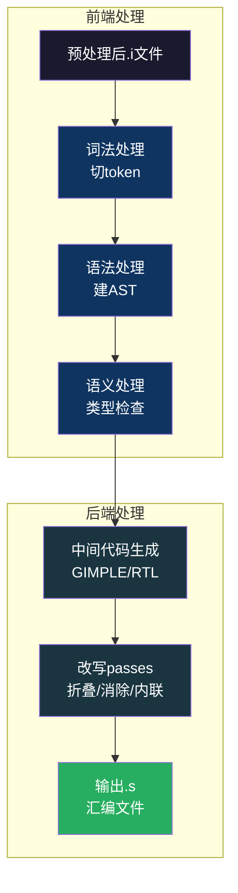
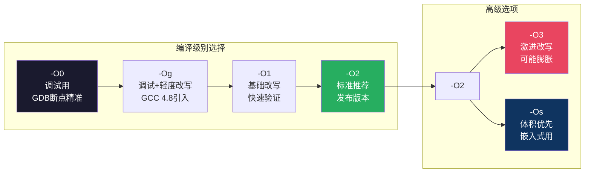

# 【金丹·63】编译：C代码怎么变成汇编

> **码农修仙传 · 金丹期 · 第63篇**
> 我是玄芯散人，带你从炼气修到大乘。

---

## 境界标识

```
╔══════════════════════════════════╗
║     金丹期 · 第63篇              ║
║     编译                          ║
║     C代码怎么变成汇编             ║
║     预计阅读：15分钟              ║
╚══════════════════════════════════╝
```

---

## 修仙引入

上一篇讲了预处理：预处理器把#include和#define做了一遍文本替换，吐出来一个纯文本的 `.i` 文件。但这个文件里还是C代码，CPU一个字都不认识。

编译器干的事，就是把C代码翻译成汇编。这中间不是逐行翻译就完事了。编译器要先看懂你的代码结构，再做一轮改写，最后才输出汇编指令。看懂代码靠的是前端处理，改写代码靠的是代码改写和生成。

很多人以为编译器就是个翻译机，你写什么它翻什么。实际上编译器比你想象的聪明得多，也鸡贼得多。它会偷偷删掉你写的废代码，帮你算好常量，把循环拆开，甚至把函数调用直接塞进调用者的代码里。你写的代码和你跑的代码，可能差了十万八千里。

金丹期要看透这层黑箱。今天拆开编译器，看看它到底对你的代码做了什么。

---

## 硬核主体

### 编译器的四个阶段

GCC把编译这一步拆成了几个子阶段。预处理之后，真正的编译器开始干活：

```bash
# 只做编译，不汇编不链接，输出汇编文件
gcc -S main.c -o main.s

# 想看编译器内部各阶段的输出，用dump选项
gcc -fdump-tree-all -O2 main.c -o main
# 会在当前目录生成一堆 .tuv文件，每个对应一个编译pass
```

编译器内部分几个阶段，每个阶段处理一种任务：



注意区分两个概念：GCC的"编译"是指预处理之后到汇编输出之前的整个过程。而编译器内部的前端处理（词法到语义）是编译的前半段，代码改写和生成是后半段。化神期127-132会讲怎么手写这些阶段，金丹期只需要理解每一步在干什么。

### 词法处理：把代码切成token

编译器拿到 `.i` 文件后，第一件事是做词法处理。这一步把你的源代码字符流切成一个个有意义的单元，叫做token。

```c
// 你的代码
int sum = 1 + 2;
```

词法处理器看到的是一连串字符：`i n t 空格 s u m 空格 = 空格 1 空格 + 空格 2 ;`

它把这些字符切分成token序列：

| token类型 | 内容 | 含义 |
|-----------|------|------|
| 关键字 | int | 类型声明 |
| 标识符 | sum | 变量名 |
| 运算符 | = | 赋值 |
| 常量 | 1 | 整数字面量 |
| 运算符 | + | 加法 |
| 常量 | 2 | 整数字面量 |
| 分隔符 | ; | 语句结束 |

词法处理工具不关心代码的意思，它只管切分。空格和注释会被丢掉，换行符也不影响切分结果。这一步如果发现非法字符（比如C语言里不允许的 `@` 符号），直接报错。

### 语法处理：建AST语法树

拿到token序列后，编译器进入语法处理阶段。这一步根据C语言的语法规则，把token组装成一棵抽象语法树（AST）。

AST是代码结构的树形表示。上面那段 `int sum = 1 + 2;` 的AST大致长这样：

```
        声明语句
       /        \
   类型int     赋值
              /    \
           变量sum   加法
                    /   \
                  常量1  常量2
```

语法处理器用的是递归下降的方式，按语法规则自顶向下匹配。遇到 `int` 就知道这是声明，遇到 `=` 就知道这是赋值，遇到 `+` 就知道这是加法表达式。如果token序列不符合语法规则（比如 `int = + ;`），这一步会报语法错误。

GCC内部用的是GENERIC表示，基本就是AST的C语言结构体版本。感兴趣可以用 `gcc -fdump-tree-original` 看到它。

```bash
# 查看GCC生成的AST（原始形式）
gcc -fdump-tree-original -O0 main.c -o /dev/null
# 会生成 main.c.005t.original 文件
cat main.c.005t.original
```

输出里能看到类似这样的结构：

```
int sum;
sum = 1 + 2;
```

看起来跟源代码差不多？对，未做改写的AST基本就是源代码的另一种表示。后面改写pass会在这个结构上动刀。

### 语义处理：类型检查和符号表

语法树建好了，但编译器还不知道每个变量是什么类型，函数参数对不对。语义处理这一步负责检查类型是否匹配，变量是否声明过，函数调用的参数个数对不对。

编译器维护一张符号表，记录每个变量的名字和类型和作用域。遇到 `sum = 1 + 2` 时，语义处理器查符号表确认sum是int类型，1和2也是int，加法结果也是int，类型匹配，通过。

如果写成 `int *p = 1 + 2;`，语义处理器会报错：把int赋值给指针，类型不兼容。语法上没问题（赋值语句结构正确），但语义上不允许。

### 中间代码和改写

语义处理通过后，编译器把AST翻译成中间表示（IR）。GCC用两种IR：GIMPLE和RTL。GIMPLE是一种简化的三地址码，每条指令最多三个操作数。

```c
// 你写的
int sum = 1 + 2;

// GIMPLE中间表示（简化版）
sum = 1 + 2;
```

到了这一步，改写passes开始上场。GCC的改写以"pass"为单位，每个pass遍历一次中间代码，做一种特定的改写。用 `gcc -fdump-tree-all` 能看到所有pass的输出，数量可能超过100个文件。

常用的几个改写pass：

常量折叠：编译时能算出来的常量表达式，直接算成结果。

```c
// 你写的
int seconds = 60 * 60 * 24;

// 常量折叠后
int seconds = 86400;
```

常量折叠在-O1及以上自动开启。生成的汇编里不会有乘法指令，只有一个立即数86400。

死代码消除：写了但从未使用的变量，直接删掉。

```c
// 你写的
int unused = 42;
int a = 1 + 2;

// 死代码消除后
int a = 3;   // unused被删了，1+2被常量折叠成3
```

循环展开：把循环体复制几次，减少循环判断和跳转的开销。

```c
// 你写的
for (int i = 0; i < 4; i++) {
    sum += arr[i];
}

// 展开后（-O3）
sum += arr[0];
sum += arr[1];
sum += arr[2];
sum += arr[3];
```

展开后少了4次条件判断和跳转指令，跑得更快，代价是代码体积变大。-O3才会做这个，-O2默认不展开。

函数内联：把短函数的代码直接复制到调用处，省掉函数调用的开销。函数调用要压栈保存寄存器，跳转到函数地址，返回时再恢复寄存器，这些开销对小函数来说占比很大。

```c
// 你写的
static inline int square(int x) { return x * x; }
int a = square(5);

// 内联+常量折叠后
int a = 25;
```

注意 `static` 修饰符。如果没有static，编译器不一定敢内联，因为其他.c文件可能也调用了这个函数。static告诉编译器这个函数只在当前文件使用，内联是安全的。

### 编译级别怎么选

GCC提供五个编译级别，每个级别开启不同数量的改写pass：

```bash
gcc -O0 main.c   # 不优化（默认）
gcc -O1 main.c   # 基础优化
gcc -O2 main.c   # 标准推荐
gcc -O3 main.c   # 激进优化
gcc -Os main.c   # 体积优先
```

各个级别的区别：

-O0不开启任何改写。你写的代码长什么样，生成的汇编就长什么样。每行C代码精确对应一组汇编指令，调试时GDB断点能准确停在你写的行上。开发阶段用这个。

-O1开启基础改写，包括常量折叠和死代码消除。编译速度只比-O0慢一点，生成的代码明显更快。快速验证编译是否通过时用。

-O2是发布版本的默认选择。在-O1基础上开启了大量改写pass，包括指令调度和分支预测。编译速度比-O1慢，但生成的代码质量好很多。绝大多数软件的发布版本用-O2。

-O3在-O2基础上开启了激进改写，包括循环展开和函数内联。生成的代码执行速度最快，但体积会膨胀（循环展开和内联都增加代码量）。有时候-O3反而比-O2慢，因为代码膨胀导致指令缓存命中率下降。

-Os在-O2基础上关闭了所有增大代码体积的改写，目标是生成最小的二进制文件。嵌入式系统Flash空间紧张时用这个。

| 级别 | 编译速度 | 执行速度 | 代码体积 | 适用情况 |
|------|---------|---------|---------|---------|
| -O0 | 最快 | 最慢 | 中等 | 调试 |
| -O1 | 快 | 较快 | 较小 | 快速验证 |
| -O2 | 中 | 快 | 较小 | 发布版本（默认推荐） |
| -O3 | 慢 | 最快 | 最大 | 性能敏感（可能膨胀） |
| -Os | 中 | 较快 | 最小 | 嵌入式（Flash紧张） |

嵌入式开发通常在-Os和-O2之间选。-Os适合Flash空间紧张的MCU（比如STM32F103只有64KB Flash），-O2适合存储空间充裕的设备。嵌入式几乎不用-O3，因为循环展开导致代码膨胀会吃掉宝贵的Flash，得不偿失。

### 一个实验：亲眼看编译器改了多少

写一个简单的C文件，用不同编译级别编译，对比汇编输出：

```c
// main.c
int compute(int a, int b) {
    int unused = 42;        // 死代码
    int result = a + b;
    return result * 2;
}

int main(void) {
    int x = compute(3, 4);
    return x;
}
```

```bash
# 生成汇编（-S只编译到汇编，不汇编不链接）
gcc -O0 -S main.c -o main_O0.s
gcc -O2 -S main.c -o main_O2.s
gcc -O3 -S main.c -o main_O3.s

# 对比汇编行数
wc -l main_O0.s main_O2.s main_O3.s
```

-O0的汇编最长，每行C代码对应多条汇编指令，unused变量还在内存里占着位置。-O2短了很多，unused被删了，compute函数可能被内联到main里。-O3和-O2在这个简单例子里差别不大，因为没什么循环可以展开。

用 `gcc -O2 -S` 编译上面那段代码，compute函数很可能被整个内联+常量折叠掉，main函数变成直接返回14：

```asm
main:
    mov    eax, 14     ; 3+4=7, 7*2=14, 全部编译时算好了
    ret
```

这就是编译器改写的威力。你写的函数调用和参数传递和局部变量，在-O2下全部消失，变成一个立即数返回。

### 调试和编译级别的矛盾

用-O0调试时，GDB断点准确停在源代码的每一行，变量值随时可看。但换成-O2后，调试体验会变差。因为编译器重排了指令顺序，删掉了变量（可能存在寄存器里而不是内存里），有些变量被常量折叠消失了。

GDB在-O2下断点可能跳来跳去，某些变量显示 `<optimized out>`，表示这个变量被改写掉了，调试器找不到它。

```bash
# 推荐的调试编译方式：保留调试信息但开基础改写
gcc -g -Og main.c -o main    # -Og是GCC 4.8引入的调试友好编译级别
```

-Og是专门为调试设计的编译级别，只开启不影响调试体验的改写pass。保留了-O0的调试友好性，同时代码不会太慢。



### 编译器能做的和不能做的

编译器很聪明，但也有边界。它能做的是局部改写：删死代码，折叠常量，展开循环，内联函数。它不能做的是改变算法的时间复杂度。如果你写了个O(n²)的冒泡排序，编译器不会帮你变成O(n log n)的快排。

编译器也不能猜你的意图。如果你写了 `if (a = 1)`（赋值而不是比较），编译器可能给你一个warning，但它不会帮你改成 `if (a == 1)`。在C语言里，赋值表达式的值就是被赋的值，`a = 1` 的值是1（真），所以这个if永远为真，但语法上完全合法。

理解编译器的能力边界，才能写出编译器帮得上忙的代码。把常量提取出来让编译器折叠，用static修饰让编译器敢于内联，这些都是"配合编译器"的写法。

---

## 修仙术语对照表

| 修仙术语 | 技术现实 | 本篇位置 |
|----------|---------|---------|
| 炼丹分解 | 词法处理切token | 词法处理节 |
| 语法灵纹 | AST抽象语法树 | 语法处理节 |
| 类型查根 | 语义处理类型检查 | 语义处理节 |
| 中转灵文 | GIMPLE中间表示 | 中间代码节 |
| 炼丹预判 | 常量折叠 | 改写passes节 |
| 删废功法 | 死代码消除 | 改写passes节 |
| 功法展开 | 循环展开 | 改写passes节 |
| 法术融体 | 函数内联 | 改写passes节 |
| 修炼档位 | 编译级别-O0到-O3 | 编译级别节 |
| 精简功法 | -Os体积优先 | 编译级别节 |
| 暗箱改写 | 编译器改写passes | 全篇 |
| 调试天眼 | GDB调试+调试信息 | 调试矛盾节 |
| 功法边界 | 编译器能力边界 | 边界节 |

---

## 进阶条件

会写代码和理解编译器改了什么之间，差这几条：

- [ ] 能用 `gcc -S` 生成汇编文件，看编译器输出了什么指令
- [ ] 知道词法处理和语法处理和语义处理和代码生成这几步各自做什么
- [ ] 能解释常量折叠为什么把 `60*60*24` 变成 `86400`
- [ ] 知道死代码消除和循环展开和函数内联各是什么，分别在哪个编译级别开启
- [ ] 能说出-O0和-O2和-O3和-Os的区别和各自适用的情况
- [ ] 嵌入式项目能说清楚选-Os还是-O2的理由
- [ ] 用 `gcc -fdump-tree-all` 看过至少一次编译器各pass的输出

> 最后一条是金丹期的实操分水岭。编译级别不是随便选的，它决定代码体积和执行速度和调试体验的权衡。

---

## 下期预告 + 互动

> 下一篇：【金丹·64】undefined reference：链接器原理
>
> 编译器把C代码变成了汇编，汇编器又把汇编变成了机器码（.o文件）。但你的代码调用了printf，printf的实现在libc库里。谁负责把你的.o和库拼在一起？链接器。
> 下篇讲链接器怎么干活，以及为什么你会遇到undefined reference。

现在问你：

> 你试过用 `gcc -S` 看汇编输出吗？第一次看到编译器生成的汇编是什么感觉？
>
> 你的嵌入式项目用-O0还是-O2还是-Os？为什么选这个级别？
>
> 评论区聊聊你跟编译器打交道的经历。

> 我是玄芯散人，带你从炼气修到大乘。

---

*本文是「码农修仙传」系列第63篇。系列导航见 [xren.ren](https://xren.ren)*
