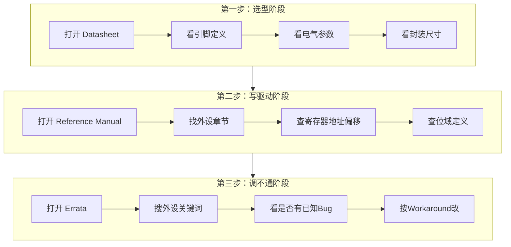
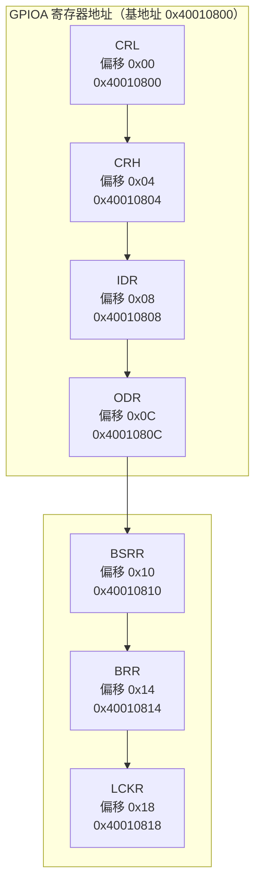

# 【元婴·95】Datasheet怎么读：嵌入式工程师的必修课

> 码农修仙传 · 元婴期 · 第95篇
> 我是玄芯散人，带你从炼气修到大乘。

---

## 境界标识

```
╔══════════════════════════════════╗
║     元婴期 · 第95篇              ║
║     Datasheet怎么读              ║
║     预计阅读：15分钟              ║
╚══════════════════════════════════╝
```

---

## 修仙引入

修真小说里，主角捡到一件上古法器，第一件事是什么？翻找器灵留下的炼制手册。不查手册就乱灌灵力，法器炸了不说，可能连人一起带走。

嵌入式工程师的"法器手册"就是 Datasheet。芯片厂商把引脚定义、寄存器地址还有电气参数全写在这份 PDF 里。你不去读它，写出来的代码就是盲猜。运气好跑通了，运气不好芯片冒烟，排查三天找不到原因，最后发现是某个引脚的最大灌电流只有 8mA，你推了 20mA 进去。

这一篇教你把几千页的英文 PDF 当工具用，而不是当催眠读物。

---

## 硬核主体

### 三种文档要分清

ST 官网搜 STM32F103，你能下载到好几个 PDF，名字不一样，内容差很多。新手最大的坑就是把 Datasheet 当万能手册翻，发现里面没有寄存器位域说明，就觉得厂商文档不全。

其实 ST 对 STM32 系列芯片提供三种文档，各管一段：

| 文档 | 页数 | 内容 | 什么时候翻 |
|------|------|------|-----------|
| Datasheet | 约 30-80 页 | 引脚定义，电气参数，封装，外设概述 | 选型画板分配引脚 |
| Reference Manual (RM) | 1000+ 页 | 每个外设的寄存器全集，位域，时序 | 写驱动配寄存器 |
| Errata (ES) | 10-30 页 | 芯片已知Bug列表和规避方法 | 调不通时排查 |

Datasheet 告诉你芯片"是什么"，Reference Manual 告诉你"怎么用"，Errata 告诉你"哪里有坑"。

一个常见的踩坑情况：你按 Datasheet 上的引脚概述写了 SPI 代码，跑起来 MISO 引脚读出来全是 0。翻 Reference Manual 才发现，这个引脚的 SPI 复用功能要配 AF5，你配成了 AF0。Datasheet 的引脚表只写了 SPI1_MISO，但没告诉你 AF 编号。



### Datasheet 结构拆解

拿 STM32F103C8T6 的 Datasheet 举例（数据手册编号 DS5319，对应的参考手册是 RM0008）。翻目录，你会看到这几个板块。

Pinout and Pin Descriptions（引脚定义）：每个封装对应的引脚排列。不同封装引脚数不一样，同一个功能可能在不同封装上对应不同引脚号。这里还标注了引脚类型，比如电源脚、I/O 脚、复位脚、晶振脚，以及默认复用功能。

Electrical Characteristics（电气参数）：这里是你芯片不烧毁的保命线。关注几个值：
- VDD 供电范围（2.0V 到 3.6V）
- GPIO 输出灌电流/拉电流上限（通常 25mA，但全端口总和有上限）
- 输入漏电流
- 复位脚电平阈值

Memory Map（存储器地址表）：一张表列出所有外设的基地址。比如 GPIOA 基地址 0x40010800，USART1 基地址 0x40013800。写裸机寄存器代码时，你的头文件里那些宏定义就是照这张表抄的。

Peripheral Descriptions（外设概述）：每个外设给一两页简介。注意这里是概述不是全量寄存器说明。全量寄存器表在 Reference Manual 里。

### Reference Manual 怎么翻

Reference Manual（以下简称 RM）是真正写代码时用的手册。STM32F103 对应 RM0008，一千多页。不可能逐页翻，得学会"按需查询"。

假设你要写一个 GPIO 输出驱动 LED，步骤如下。

第一步，翻目录找 GPIO 章节。RM0008 里 GPIO 在第 8 章（不同 RM 章节号不同，以目录为准）。

第二步，看寄存器列表。GPIO 外设有几个寄存器：

```c
// STM32F103 GPIO 寄存器结构（基地址 0x40010800）
typedef struct {
    volatile uint32_t CRL;   // 端口配置低寄存器，控制 Pin 0-7
    volatile uint32_t CRH;   // 端口配置高寄存器，控制 Pin 8-15
    volatile uint32_t IDR;   // 输入数据寄存器，只读
    volatile uint32_t ODR;   // 输出数据寄存器，读写
    volatile uint32_t BSRR;  // 端口位设置/清除寄存器，写1有效
    volatile uint32_t BRR;   // 端口位清除寄存器，写1有效
    volatile uint32_t LCKR;  // 配置锁定寄存器
} GPIO_TypeDef;
```

第三步，查位域。CRL 寄存器每个引脚占 4 位，分 MODE 和 CNF 两段。MODE 两位决定输出方向和速度，CNF 两位决定功能类型。输出时 CNF 可以是推挽、开漏、复用推挽或复用开漏四种。

```
CRL 寄存器位域（每4位管一个Pin，Pin0在 bit 0-3）：
┌──────┬──────┬──────┬──────┐
│ MODE │ CNF  │ MODE │ CNF  │
│ [1:0]│ [3:2]│ [5:4]│ [7:6]│
│ Pin0 │ Pin0 │ Pin1 │ Pin1 │
└──────┴──────┴──────┴──────┘

MODE: 00=输入, 01=输出10MHz, 10=输出2MHz, 11=输出50MHz
CNF (输入时): 00=模拟, 01=浮空, 10=上拉/下拉
CNF (输出时): 00=推挽, 01=开漏, 10=复用推挽, 11=复用开漏
```

这里有个新手常犯的错。MODE=01 对应 10MHz 输出速度，MODE=10 对应 2MHz。数字大小和速度大小不对应，01 是中间档不是最慢档。这个对应关系在 RM0008 的 GPIO 章节寄存器表里写得很清楚，但很多人不看原文，靠猜。

第四步，写代码。查到信息后，你的驱动代码就有依据了：

```c
// 配置 PA5 为推挽输出，速度 2MHz
// 查 RM0008: MODE=10 -> 2MHz, CNF=00 -> 推挽输出
// PA5 对应 CRL 的 bit[23:20]
GPIOA->CRL &= ~(0xFF << 20);     // 清除 PA5 的 4 位
GPIOA->CRL |= (0x02 << 20);      // MODE=10(2MHz), CNF=00(推挽)
GPIOA->ODR |= (1 << 5);          // PA5 输出高
```

### 用地址偏移定位寄存器

RM 里每个寄存器除了名字，还有一个"地址偏移"（Address Offset）。GPIO 的基地址是 0x40010800，CRL 的偏移是 0x00，CRH 是 0x04，IDR 是 0x08，以此类推。

实际地址 = 基地址 + 偏移。



你不需要记地址。头文件 `stm32f103xb.h` 已经帮你把结构体和宏定义好了。但你需要理解这个对应关系，因为有时候你调试时要在内存查看器里手动输入地址看寄存器值，就得会算。

### Errata：芯片的"已知Bug公告"

Errata 是 ST 官方发布的芯片缺陷清单。芯片流片后发现某些功能不正常，厂商来不及改版，就发一份 Errata 告诉你：这个功能有问题，这样用可以规避。

举例：STM32F103 的某些批次存在 I2C 外设的已知问题。在 Errata 文档里搜 I2C，能看到描述比如"START 条件可能不会被正确发送"，Workaround 会告诉你用什么方式绕过。

调试时遇到的诡异问题，先查 Errata。很多人在这个环节浪费大量时间，反复查自己代码，最后发现是芯片本身的问题，厂商早就记录在案了。

### Datasheet 阅读实战：找时钟配置参数

以时钟树配置为例。假设你要把 STM32F103 的系统时钟降到 64MHz，需要查 PLL 配置参数。

第一步，打开 RM0008，翻到 RCC 章节（时钟控制器）。

第二步，找到 PLL 配置寄存器 RCC_CFGR。里面的 PLLMUL 位域决定 PLL 倍频系数。

第三步，看位域表。PLLMUL[3:0] 占 bit 18-21，值 0000 到 0111 对应倍频 2 到 9，值 1000 到 1111 保留。你要 64MHz，HSE 是 8MHz，需要 8 倍频，PLLMUL 设 0110。

```c
// 系统时钟配 64MHz：HSE 8MHz × 8 = 64MHz
// 查 RM0008 RCC_CFGR: PLLMUL[3:0] = 0110 -> 倍频 ×8
RCC->CFGR &= ~RCC_CFGR_PLLMUL;     // 清除倍频位
RCC->CFGR |= (0x06 << 18);          // PLLMUL = 0110 -> ×8
RCC->CR |= RCC_CR_PLLON;            // 开启 PLL
while(!(RCC->CR & RCC_CR_PLLRDY));  // 等待 PLL 锁定
RCC->CFGR |= RCC_CFGR_SW_PLL;       // 切换系统时钟源到 PLL
```

这个过程里，每一步的寄存器名和位域位置还有值的含义，都是查 RM 来的，不是编的。你把这些查文档的习惯养成后，换一颗没见过的芯片也能上手。

### 几个读 Datasheet 的实用技巧

第一，用 PDF 搜索而不是逐页翻。打开 PDF，Ctrl+F 搜寄存器名，比翻目录快十倍。搜 "GPIOC_CRL" 直接跳到对应章节。

第二，关注"Reserved"位。寄存器表里标 Reserved 的位永远写 0，不要写 1。写了可能触发未定义行为。

第三，电气参数表的脚注要读。表格下面的小字经常藏着限制条件。比如 GPIO 灌电流标 25mA，脚注可能写"单个端口总电流不超过 150mA"。

第四，时序图要看沿和标注。时序图上每个箭头标的 tSU、tHD 等参数在表格里对应具体值。你的代码逻辑要对得上这些时序要求。

---

## 修仙术语对照表

| 修仙术语 | 技术现实 | 本篇位置 |
|---------|---------|---------|
| 法器手册 | Datasheet 芯片数据手册 | 修仙引入 |
| 炼制手册 | Reference Manual 参考手册 | 三种文档要分清 |
| 已知Bug公告 | Errata 芯片勘误表 | 三种文档要分清 |
| 灵脉地址 | 外设基地址（如 0x40010800） | 用地址偏移定位寄存器 |
| 经脉穴位 | 寄存器位域（MODE/CNF） | Reference Manual 怎么翻 |
| 周天运行 | 时钟树 PLL 配置 | Datasheet 阅读实战 |
| 功法运转速度 | GPIO 输出速度（2/10/50MHz） | Reference Manual 怎么翻 |
| 灵力灌注极限 | GPIO 最大灌电流/拉电流 | Datasheet 结构拆解 |
| 禁制 | Reserved 位必须写0 | 读 Datasheet 的实用技巧 |
| 器灵留言 | 时序图脚注限制条件 | 读 Datasheet 的实用技巧 |
| 天机碎片 | Errata 中的 Workaround | Errata 章节 |
| 灵脉接驳 | 时钟使能（RCC 外设时钟开启） | 寄存器配置代码 |
| 进阶条件 | 按文档写代码不靠猜 | 贯穿全文 |

---

## 进阶条件

- [ ] 能区分 Datasheet、Reference Manual、Errata 三种文档的用途
- [ ] 能在 Reference Manual 中找到指定外设的寄存器列表和位域定义
- [ ] 能用"基地址 + 偏移"算出任意寄存器的实际地址
- [ ] 知道 GPIO 的 MODE 和 CNF 位域各两位的值含义，不靠猜
- [ ] 遇到诡异问题会先查 Errata 而不是反复改自己的代码
- [ ] 能看懂时序图的参数标注并在代码中对应实现
- [ ] 电气参数表的脚注会读，不忽略端口总电流限制

下一篇我们进入布尔代数和数字电路的数学原理，看看 0 和 1 背后的数学法则到底是怎么支撑整个数字世界的。

---

## 下期预告 + 互动

下一篇：0和1背后的数学：布尔代数和数字电路基础。布尔代数公理，逻辑化简方法，卡诺图技巧，数字电路的数学原理。

互动问题：你第一次读 Datasheet 踩过什么坑？有没有因为没查 Errata 浪费好几天的经历？评论区聊聊。

我是玄芯散人，带你从炼气修到大乘。

---

*本文是「码农修仙传」系列第95篇。系列导航见 [xren.ren](https://xren.ren)*
