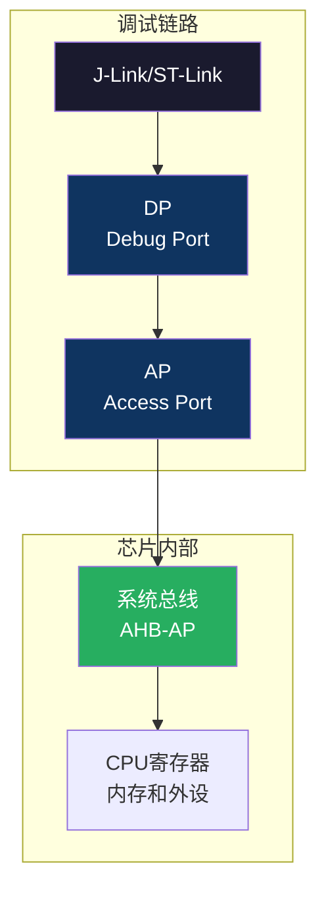
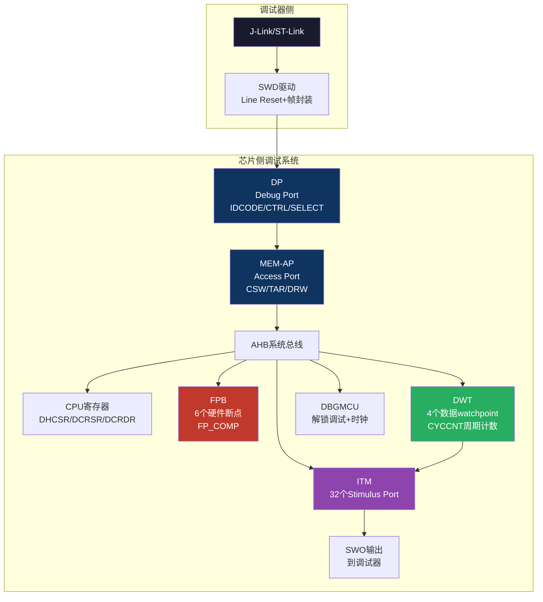

# 【元婴·118】调试器原理：JTAG/SWD怎么看见你的代码

> **码农修仙传 · 元婴期 · 第118篇**
> 我是玄芯散人，带你从炼气修到大乘。

---

## 境界标识

```
╔══════════════════════════════════╗
║     元婴期 · 第118篇             ║
║     调试器原理                    ║
║     JTAG/SWD怎么看见你的代码      ║
║     预计阅读：12分钟              ║
╚══════════════════════════════════╝
```

---

## 修仙引入

你天天用J-Link或ST-Link调试：打断点，单步执行，看变量值。但你想过没有，调试器怎么做到这些的？

你的代码跑在STM32的Flash里，调试器是一个外部设备，它怎么知道CPU执行到哪了？怎么在你设的断点处停下来？怎么读到变量的值？

答案是一套叫"Debug Port"和"Access Port"的硬件总线，加上几个专门的调试寄存器。CPU内部有一整套调试硬件，你的J-Link只是跟这些硬件"对话"的工具。

今天拆开调试器的底层原理：JTAG和SWD接口和DP/AP总线和硬件断点和软件断点的区别和SWO单线追踪怎么输出printf。然后往深处走，看DWT怎么监控数据访问和测量代码耗时，半主机模式怎么让调试器替你做I/O，SWD协议帧长什么样，最后把所有零件串成一次调试会话的全流程。

---

## 硬核主体

### JTAG vs SWD：两种调试接口

JTAG是最早的调试接口，4根信号线：TCK（时钟）和TMS（模式选择）和TDI（数据输入）和TDO（数据输出），加上复位线nRST一共5根。它最初是为芯片测试设计的（边界扫描），后来被借用来做调试。

SWD（Serial Wire Debug）是ARM专门为调试设计的2线接口：SWCLK（时钟）和SWDIO（数据双向），加上复位线nRST一共3根。比JTAG省2根引脚，在引脚紧张的MCU上更常用。

两种接口功能一样，SWD是JTAG的精简版。STM32F4默认用SWD，因为PA13/PA14两根线就够了。

### DP和AP：调试器的两段式总线

调试器访问MCU内部资源，要经过两道关卡：



DP（Debug Port）是第一道关卡。调试器通过SWD接口跟DP通信，DP负责把SWD的串行协议转成内部总线信号。DP里有几个寄存器：IDCODE（芯片ID）和CTRL/STAT（控制状态）和SELECT（选择哪个AP）和RDBUFF（读缓冲）。

AP（Access Port）是第二道关卡。DP选好AP后，通过AP访问系统总线。最常用的是MEM-AP（内存访问AP），它能让调试器像CPU一样读写内存和寄存器。

调试器读一个变量的流程：
1. 调试器通过SWD写DP的SELECT寄存器，选择MEM-AP
2. 写AP的TAR（Transfer Address Register），设置要读的地址
3. 读AP的DRW（Data Read/Write），拿到数据
4. 数据通过DP的RDBUFF返回调试器

整个过程不需要CPU参与，调试器直接访问系统总线。

### 硬件断点 vs 软件断点

断点有两种实现方式，原理完全不同。

硬件断点：用FPB（Flash Patch and Breakpoint）单元。FPB里有几个地址比较器，CPU每次取指令时FPB会比较地址，如果匹配就触发调试异常，CPU停下来。STM32F4有6个硬件断点。硬件断点可以直接在Flash里设，因为不修改Flash内容。

软件断点：调试器把目标地址的指令替换成BKPT指令（机器码0xBE00）。CPU执行到BKPT时触发调试异常。断点取消时再把原始指令写回去。软件断点数量不限，但只能用在RAM里（Flash需要擦写才能替换）。

BKPT指令编码是0xBE00到0xBEFF，低8位是立即数imm8。调试异常处理程序可以读imm8区分是软件断点还是半主机调用（半主机用0xAB）。这个imm8也可以用来标记不同断点的编号，方便调试器知道是哪个断点触发的。

你在Keil里打断点时：
- 代码在Flash里 → 默认用硬件断点（最多6个）
- 代码在RAM里 → 用软件断点（不限数量）
- 硬件断点用完了 → 调试器可能自动转软件断点（RAM调试时才行）

还有一个容易踩的坑：在Flash里设了超过6个断点，Keil不会报错，但第7个及以后的断点不生效。你以为代码跑过了那段，其实没停下来过。调试时如果发现某个断点不触发，先数数你一共设了几个。

### SWO追踪：单线输出printf

嵌入式调试有个痛点：想看变量值但UART被占用了，或者printf太慢拖累实时性。SWO（Serial Wire Output）解决了这个问题。

SWO是单根输出线，跟SWD的SWCLK和SWDIO复用调试接口，但数据流向是MCU输出到调试器。它通过ITM（Instrumentation Trace Macrocell）模块工作。

```c
// 通过ITM输出printf（不需要UART）
#define ITM_Port32(n) (*((volatile unsigned int *)(0xE0000000 + 4*n)))

void ITM_SendChar(char ch) {
    while (ITM_Port32(0) == 0);  // 等Stimulus Port 0就绪
    *((volatile char *)0xE0000000) = ch;
}
```

ITM有32个Stimulus Port，每个port可以写数据。SWO以高速（通常是CPU时钟或分频）把ITM数据串行输出到调试器，调试器再转发给电脑显示。速度远超UART，且不占用任何外设引脚。

SWO有两种时钟模式：编码模式（NRZ，跟SWCLK同步）和曼彻斯特模式（自同步）。Keil和STM32CubeIDE默认用编码模式，波特率设成跟ITM时钟一致。如果SWO配置后没输出，十有八九是时钟分频系数算错了。

### DWT：数据跟踪和性能计数

ITM负责输出printf，DWT（Data Watchpoint and Trace）负责另一件事：监控数据访问和性能。

DWT有几个能力：

1. 数据断点（Watchpoint）：跟FPB的指令断点不同，DWT监控的是数据访问。你在某个变量上设watchpoint，CPU读写这个变量时就会触发。STM32F4的DWT有4个比较器，可以配成地址比较，匹配读或写或读写都触发。

```c
// 手动配置一个数据watchpoint：监控变量 flag 的写入
volatile int flag = 0;
// flag 的地址写入 DWT FUNC0，配成写触发
DWT->COMP0 = (uint32_t)&flag;       // 比较地址
DWT->MASK0 = 0;                     // 地址掩码（0=精确匹配）
DWT->FUNCTION0 = 0x6;               // bit5:1=写触发, bit0=1使能
// CPU 每次写 flag 时触发调试事件
```

2. 周期计数器（CYCCNT）：DWT里有一个32位的CPU时钟周期计数器，DebugMonitor或调试器可以读它来测量代码执行时间。

```c
// 用 CYCCNT 精确测量函数耗时（单位：CPU时钟周期）
DWT->CYCCNT = 0;                    // 清零
DWT->CTRL |= DWT_CTRL_CYCCNTENA_Msk; // 使能
uint32_t start = DWT->CYCCNT;
my_function();                      // 待测函数
uint32_t cycles = DWT->CYCCNT - start;
// 168MHz 主频下，1个周期 ≈ 5.95ns
// cycles=1000 → 约 5.95us
```

3. PC采样和异常跟踪：DWT能周期性采样CPU的PC值，配合ITM输出到调试器。性能剖析工具（如SystemView/Tracealyzer）就靠这个数据画时间线。

### 半主机模式（Semihosting）

SWO/ITM解决了printf输出，但有个前提：调试器必须连着。如果调试器没连，ITM_SendChar会卡死在while循环里（Stimulus Port永远不就绪）。

半主机模式是另一种思路：CPU执行一条BKPT指令，触发调试异常，调试器截获后替你完成I/O操作（printf到控制台、scanf读键盘等）。它的好处是不依赖任何外设引脚，坏处是必须连着调试器，且每次I/O都要trap一次，速度极慢。

```c
// 半主机模式 printf 的底层实现（简化版）
// 调试器拦截 SVC/BKPT 异常，识别半主机调用号
// SYS_WRITE0 = 0x04, 把字符串地址放到r0，调用号放到r1
__attribute__((naked)) void semihosting_write0(const char *s) {
    __asm volatile(
        "mov r0, #4\n"       // SYS_WRITE0
        "bkpt #0xAB\n"       // 触发半主机异常
        "bx lr\n"
    );
}
```

裸机开发里一般不用半主机模式，而是用ITM或UART做printf。半主机模式更多用在早期没接UART的板子上，或者跑仿真器时。

### SWD协议帧格式

前面说了DP和AP两段式总线，但调试器跟DP之间的SWD协议长什么样？它不是随便发数据的，有严格的帧格式。

一个SWD操作分三步：

1. 写DP的SELECT寄存器选择目标AP和AP_bank
2. 写AP的CSW（Control Status Word）配置传输参数（大小端、传输位宽等）
3. 写TAR设地址，读/写DRW搬数据

SWD每个包的帧格式：8 bit包头 + 32 bit数据 + 1 bit奇偶校验 + 2 bit停止位。包头里包含读写标记、AP/DP选择、寄存器地址（2 bit编码8个寄存器）。

通信开始前必须做一次Line Reset：连续50个以上的1，让DP重新同步。如果调试器连不上芯片，第一步就是检查Line Reset有没有发出去。

### 一次调试会话的全流程

把前面的零件串起来，看一次调试会话从头到尾长什么样：

1. 调试器通过SWD发送Line Reset，同步DP
2. 读DP的IDCODE寄存器，确认芯片型号（STM32F407的IDCODE是0x4BA00477）
3. 写DP的CTRL/STAT，使能调试 power
4. 写DP的SELECT选择MEM-AP
5. 通过MEM-AP写系统总线，解锁调试（STM32F4的DBGMCU_CR寄存器）
6. 读DHCSR确认CPU状态（halted还是running）
7. 设置断点：写FP_COMP寄存器配断点地址
8. 让CPU继续跑：写DHCSR的C_DEBUGEN和C_HALT位
9. CPU命中断点后读PC和寄存器（DCRSR/DCRDR）
10. 用户单步执行：写DHCSR的STEP位

整个过程里调试器和芯片之间交换了几百个SWD包，但都是在毫秒级完成的，用户感知不到。

### Cortex-M4调试系统全景

把前面所有模块画到一张图里：



调试器通过DP和AP访问系统总线，总线把信号分发到四个目标：CPU寄存器用来读寄存器，FPB用来设断点，DWT用来设watchpoint和测耗时，ITM用来输出trace。DBGMCU管解锁和调试时钟，SWO把ITM和DWT的trace数据送回调试器。

### 调试相关的寄存器

Cortex-M4的调试系统有一组寄存器，地址分布在0xE0000000开始的系统控制空间：

| 寄存器 | 地址 | 功能 |
|--------|------|------|
| DHCSR | 0xE000EDF0 | 调试主机控制状态，设置调试 halt/resume |
| DCRSR | 0xE000EDF4 | 调试寄存器选择，读写CPU寄存器 |
| DCRDR | 0xE000EDF8 | 调试寄存器数据 |
| DEMCR | 0xE000EDFC | 调试异常监控控制，使能DWT/ITM/向量捕获 |
| FP_CTRL | 0xE0002000 | FPB控制，使能硬件断点 |
| FP_COMP1 | 0xE0002008 | 断点地址比较器1 |
| DWT_CTRL | 0xE0001000 | DWT控制，使能CYCCNT和数据跟踪 |
| DWT_COMP0 | 0xE0001020 | DWT比较器0，数据watchpoint地址 |
| DWT_FUNCTION0 | 0xE0001028 | DWT功能配置，读/写触发 |
| ITM_STIM0 | 0xE0000000 | ITM Stimulus Port 0，SWO输出 |
| DBGMCU_CR | 0xE0042004 | STM32调试MCU控制，解锁调试和时钟 |

调试器设置断点时，实际就是写FP_COMP寄存器，把目标地址配进去。设置数据watchpoint时写DWT_COMP和DWT_FUNCTION。用CYCCNT测耗时先写DWT_CTRL使能再读CYCCNT。

---

## 修仙术语对照表

| 修仙术语 | 技术现实 | 本篇位置 |
|----------|---------|---------|
| 天眼通 | 调试器通过DP/AP看到CPU内部 | 引入 |
| 两道关卡 | DP和AP两段式总线 | DP/AP |
| 传令兵 | DP转SWD串行协议 | DP |
| 内务管事 | AP访问系统总线 | AP |
| 定身术 | 硬件断点FPB比较器 | 断点 |
| 替身符 | 软件断点BKPT替换指令 | 断点 |
| 传音密线 | SWO单线输出 | SWO |
| 传音阵眼 | ITM Stimulus Port | SWO |
| 周天算尺 | DWT CYCCNT周期计数器 | DWT |
| 照骨镜 | DWT数据watchpoint监控变量访问 | DWT |
| 隔空传功 | 半主机模式BKPT触发调试器代I/O | 半主机 |
| 通关令牌 | SWD Line Reset同步DP | SWD协议 |
| 巡天眼 | DWT PC采样画时间线 | DWT |
| 调度令牌 | DHCSR控制halt/resume | 寄存器 |
| 地址照妖镜 | FP_COMP地址比较器 | 寄存器 |
| 开门钥匙 | DBGMCU_CR解锁调试 | 寄存器 |

---

## 进阶条件

会用调试器和理解调试器原理之间，差这几条：

- [ ] 能说出JTAG 4线和SWD 2线的引脚名称
- [ ] 知道DP和AP的区别（DP管协议转换，AP管总线访问）
- [ ] 能解释硬件断点（FPB比较器）和软件断点（BKPT替换）的区别
- [ ] 知道STM32F4有6个硬件断点(FPB)和4个DWT数据watchpoint
- [ ] 能配置SWO/ITM输出printf，不占用UART
- [ ] 能用DWT的CYCCNT测量一段代码的执行周期数
- [ ] 知道DHCSR/DEMCR/FP_COMP/DWT_CTRL等调试寄存器的功能
- [ ] 能解释为什么软件断点只能用在RAM里
- [ ] 知道SWD通信前必须先发Line Reset同步DP
- [ ] 能说出半主机模式和ITM printf各自的优缺点

> 最后一条是元婴期的认知分水岭。调试器不是魔法，它是一套硬件总线加寄存器的组合。

---

## 下期预告 + 互动

> 下一篇：【元婴·119】示波器入门：嵌入式工程师的第三只眼
>
> 代码能跑了但信号不对？你需要示波器看波形。
> 下篇讲示波器基本操作和触发设置和I2C/SPI波形判读和电源纹波测量。

现在问你：

> 🔍 你用过SWO输出printf吗？比UART快多少？
>
> 📌 你知道你的芯片有几个硬件断点吗？用完了怎么办？
>
> 评论区聊聊你跟调试器打交道的经历。

> 我是玄芯散人，带你从炼气修到大乘。

---

*本文是「码农修仙传」系列第118篇。系列导航见 [xren.ren](https://xren.ren)*
